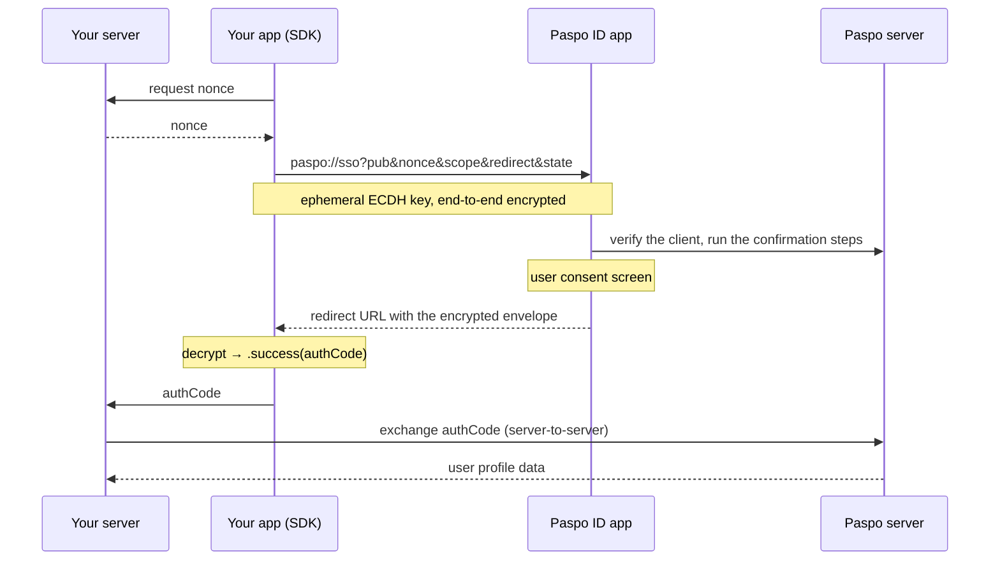

# Paspo ID iOS SDK

English | [Русский](README.ru.md)

The Paspo ID SDK adds "Sign in with Paspo ID" to your iOS app. Users authenticate with their existing Paspo account in a couple of taps, and your server receives their verified profile data - phone, e-mail or national ID - without you building, verifying or storing those credentials yourself.

## Contents

- [Overview](#overview)
- [Requirements](#requirements)
- [Installation](#installation)
- [Project setup](#project-setup)
- [Quick start: the ready-made button](#quick-start-the-ready-made-button)
- [Custom integration](#custom-integration)
  - [SwiftUI](#swiftui)
  - [UIKit](#uikit)
- [Sign-in initiated from Paspo](#sign-in-initiated-from-paspo)
- [Checking availability](#checking-availability)
- [Authentication flow](#authentication-flow)
- [Reference](#reference)
  - [PaspoConfiguration](#paspoconfiguration)
  - [PaspoScope](#pasposcope)
  - [PaspoAuthResult](#paspoauthresult)
  - [Errors](#errors)
- [Security](#security)
- [FAQ](#faq)
- [Support](#support)

## Overview

Integration requires a single call, `authenticate(scope:nonce:)`, which returns a one-time authorization code. The application forwards this code to its server, which exchanges it with Paspo for the user's data. From the user's side, the flow is: tap "Sign in with Paspo ID", confirm on the Paspo consent screen, and return to the application.

All communication between the application and Paspo is end-to-end encrypted (ECDH P-256 + AES-256-GCM, with ephemeral keys held only in memory) and handled by the SDK; no cryptographic work is required on your side.

Two responsibilities remain on your server and cannot be moved to the client, as they are the basis of the flow's security: generating the `nonce`, and exchanging the authorization code for user data.

The fastest way to integrate is the [ready-made button](#quick-start-the-ready-made-button). For full control over the appearance, use the [headless API](#custom-integration).

## Requirements

| | |
|---|---|
| Deployment target | iOS 15.0 |
| Swift | 5.9 |
| Concurrency | required; `authenticate` is an `async` method |

The Paspo ID app itself requires a newer iOS than the SDK does. On devices where it cannot be installed, `authenticate` returns `.notInstalled`; this is a normal outcome and should be handled accordingly. The button can be hidden in advance via `isPaspoInstalled`.

## Installation

### Swift Package Manager

```swift
// Package.swift
dependencies: [
    .package(url: "https://github.com/pingocean/paspo-ios-sdk", from: "1.0.0"),
]
```

```swift
.target(
    name: "YourApp",
    dependencies: [
        .product(name: "PaspoID", package: "paspo-ios-sdk"),      // core, headless API
        .product(name: "PaspoIDUI", package: "paspo-ios-sdk"),    // optional, ready-made button
    ]
)
```

In Xcode: **File → Add Package Dependencies…** and paste the repository URL.

### CocoaPods

```ruby
pod 'PaspoID', '~> 1.0'      # core
pod 'PaspoIDUI', '~> 1.0'    # optional, ready-made button
```

### XCFramework

Prebuilt binaries are attached to each GitHub release. Drag `PaspoID.xcframework` (and `PaspoIDUI.xcframework`) into **Frameworks, Libraries, and Embedded Content** and set them to *Embed & Sign*. To build them yourself:

```sh
./scripts/build-xcframework.sh
```

## Project setup

Three things live in your app's configuration, and the flow does not work without them.

**1. A redirect URL.** Paspo ID returns the result by opening a URL your app owns. Use a Universal Link on a domain you control and add the associated domain:

```xml
<!-- YourApp.entitlements -->
<key>com.apple.developer.associated-domains</key>
<array>
    <string>applinks:your.app</string>
</array>
```

The path must be listed in the domain's `apple-app-site-association` file. Universal Links do not resolve in the Simulator unless that file is reachable, so development builds usually add a custom-scheme fallback:

```xml
<!-- Info.plist -->
<key>CFBundleURLTypes</key>
<array>
    <dict>
        <key>CFBundleURLName</key><string>yourapp</string>
        <key>CFBundleURLSchemes</key><array><string>yourapp</string></array>
    </dict>
</array>
```

Both URLs must be registered with Paspo during onboarding — the app rejects redirects it does not know.

**2. The `paspo` query scheme**, so the SDK can tell whether Paspo ID is installed:

```xml
<key>LSApplicationQueriesSchemes</key>
<array>
    <string>paspo</string>
</array>
```

**3. Routing incoming URLs into the SDK.** Every callback arrives as a normal deep link:

```swift
@main
struct YourApp: App {
    init() {
        Paspo.configure(
            PaspoConfiguration(
                redirectURL: URL(string: "https://your.app/paspo/callback")!,
                fallbackRedirectURL: URL(string: "yourapp://paspo-callback")!
            )
        )
    }

    var body: some Scene {
        WindowGroup {
            ContentView()
                .onOpenURL { Paspo.shared.handle(url: $0) }
                .onContinueUserActivity(NSUserActivityTypeBrowsingWeb) { activity in
                    guard let url = activity.webpageURL else { return }
                    Paspo.shared.handle(url: url)
                }
        }
    }
}
```

In UIKit, call `Paspo.shared.handle(url:)` from `scene(_:openURLContexts:)`, `scene(_:continue:)` and `scene(_:willConnectTo:options:)`.

## Quick start: the ready-made button


The ready-made button runs the entire flow on tap and blocks repeated taps while a request is in progress. It requires two inputs: a nonce provider and a result handler.

The examples reference functions that you provide:

- `backend.requestSsoNonce() async throws -> String` — requests a fresh one-time nonce from your server.
- `backend.signIn(authCode:)` — sends the authorization code to your server to complete sign-in.
- `onPaspoResult(_:)` — a single result handler, defined once:

```swift
private func onPaspoResult(_ result: PaspoAuthResult) {
    switch result {
    case let .success(authCode): Task { try await backend.signIn(authCode: authCode) }
    case let .failure(error, _): show(message(for: error))
    case .cancelled, .notInstalled: break
    }
}
```

```swift
PaspoSignInButton(
    nonceProvider: backend.requestSsoNonce,
    onResult: onPaspoResult
)
```

By default, the button is filled with the Paspo brand color. It can be styled to match your application:

```swift
PaspoSignInButton(
    scope: .phones,
    theme: .light,            // .brand (default), .light, .dark, .neutral
    cornerRadius: 12,         // the default renders a pill
    nonceProvider: backend.requestSsoNonce,
    onResult: onPaspoResult
)
```

For UIKit, add the button and bind the flow once:

```swift
let button = PaspoSignInButtonView()
button.theme = .light
button.cornerRadius = 12
button.setAuthHandler(scope: .phones, nonceProvider: backend.requestSsoNonce, onResult: onPaspoResult)
```

The button renders independently of the host theme so that it appears identical across applications. If `nonceProvider` throws, the result is `.failure(error: .serviceUnavailable, ...)`. `PaspoSignInButtonContent(colors:)` renders the same surface without running the flow, for full visual control.

| Option | Values | Default |
|---|---|---|
| `theme` | `.brand`, `.light`, `.dark`, `.neutral` | `.brand` |
| `cornerRadius` | any value; `nil` renders a pill | pill |
| `isLogoOnly` | `true` / `false` (mark only) | `false` |
| `showsLogo` | `true` / `false` (text only when `false`) | `true` |
| `title` | custom label | localized "Sign in with Paspo ID" |

## Custom integration

To use your own UI, call the SDK directly. `authenticate` never throws for flow-level outcomes: cancellation, a missing Paspo ID app and every failure come back as a `PaspoAuthResult`.

Two constraints apply:

- Only one `authenticate` may run at a time; a new call cancels the previous one.
- The instance must outlive the round trip through Paspo ID, since the result arrives as a URL. Use `Paspo.shared`, or keep your own instance on an object that is not recreated while the app is in the background.

### SwiftUI

```swift
struct LoginView: View {
    @State private var isSigningIn = false

    var body: some View {
        Button("Sign in with Paspo ID") {
            Task {
                isSigningIn = true
                defer { isSigningIn = false }
                let nonce = try await backend.requestSsoNonce()
                onPaspoResult(await Paspo.shared.authenticate(scope: .phones, nonce: nonce))
            }
        }
        .disabled(isSigningIn)
    }
}
```

### UIKit

```swift
final class LoginViewController: UIViewController {
    @objc private func signInTapped() {
        Task {
            let nonce = try await backend.requestSsoNonce()
            onPaspoResult(await Paspo.shared.authenticate(scope: .phones, nonce: nonce))
        }
    }
}
```

> If the app is terminated while the Paspo ID screen is open, the pending call is lost. Treat it as a cancellation and let the user retry.

## Sign-in initiated from Paspo

A user may also start sign-in from within Paspo. In that case Paspo opens your redirect URL with a `paspo_signin` marker and no other data. Supporting this entry point is optional:

```swift
.onOpenURL { url in
    if Paspo.shared.isSignInRequest(url: url) {
        startSignIn()
    } else {
        Paspo.shared.handle(url: url)
    }
}
```

## Checking availability

To adapt the UI before any interaction:

```swift
if Paspo.shared.isPaspoInstalled {
    // Paspo ID is installed
}
```

This check is optional: `authenticate` performs it itself and, when Paspo ID is missing, opens the App Store page from `PaspoConfiguration.appStoreURL` and returns `.notInstalled`.

`cleanup()` drops the pending flow and its ephemeral key. The SDK calls it automatically on completion and on errors; call it manually only when abandoning a flow yourself, for example when the user leaves the sign-in screen.

## Authentication flow



1. The server generates a `nonce` and provides it to the application.
2. The application calls `authenticate(scope:nonce:)`. The SDK generates an ephemeral ECDH key pair and opens Paspo ID.
3. Paspo ID verifies the client and displays the consent screen for the requested scope.
4. Upon confirmation, Paspo ID opens the redirect URL with an encrypted response; the SDK decrypts it and returns `.success(authCode:)`.
5. The application sends the code to its server, which exchanges it with Paspo for the user's data (see the Paspo server documentation).

If Paspo ID is not installed, the SDK stores the `nonce`, opens the App Store and returns `.notInstalled`. After Paspo ID is installed and `authenticate` is called again, the stored nonce is passed as a referral for install attribution.

## Reference

### PaspoConfiguration

| Property | Meaning | Default |
|---|---|---|
| `redirectURL` | Universal Link Paspo ID opens to return the result | required |
| `fallbackRedirectURL` | Custom-scheme fallback, mainly for development | `nil` |
| `bundleID` | Identifier reported to Paspo ID | main bundle's |
| `appStoreURL` | Opened when Paspo ID is missing | `nil` |
| `callbackTimeout` | Give up waiting after this long | 600 s |
| `cancellationGracePeriod` | Delay before an absent callback counts as a cancellation | 0.7 s |

### PaspoScope

The profile data requested from the user:

| Value | Returned to your server |
|---|---|
| `.phones` | Phone numbers |
| `.emails` | E-mail addresses |
| `.nationalID` | National identity document number |
| `.paspoID` | A permanent user identifier in Paspo |

### PaspoAuthResult

| Case | Payload | Action |
|---|---|---|
| `.success` | `authCode: String` | Send `authCode` to your server |
| `.cancelled` | — | The user dismissed the consent screen; typically no error UI is needed |
| `.notInstalled` | — | Paspo ID is not installed; the SDK has opened the App Store |
| `.failure` | `error: PaspoClientError`, `message: String?` | Present an error. `message` is intended for logs, not for the user |

`.cancelled` and `.notInstalled` are separate cases and never appear inside `.failure`.

### Errors

| Code | Case | Meaning |
|---|---|---|
| 100 | `.unknown` | Unknown error |
| 101 | `.invalidRequest` | Malformed request or corrupted data |
| 102 | `.serviceUnavailable` | Paspo is temporarily unavailable |
| 103 | `.cancelled` | The user cancelled the operation |
| 110 | `.sessionExpired` | The session expired; restart with a new nonce |
| 111 | `.packageVerificationFailed` | The application failed Paspo's verification. Ensure the bundle identifier and redirect URL are registered during onboarding |
| 120 | `.accessDenied` | The user denied access |
| 121 | `.identityNotVerified` | The user's identity is not verified in Paspo |
| 122 | `.attemptsExceeded` | Too many attempts |
| 123 | `.actionNotAllowed` | Not available for this user |
| 130 | `.authMethodUnavailable` | The confirmation method is temporarily unavailable |
| 131 | `.unsupportedAuthMethod` | The confirmation method is not supported |
| 140 | `.paspoNotInstalled` | Paspo ID is not installed |
| 141 | `.cryptoError` | Encryption or decryption error; restart the flow |

The codes are identical to the Android SDK, so one error table serves both platforms.

## Security

- Keys are ephemeral: a new ECDH pair is generated per `authenticate` call, held only in process memory and destroyed once the response is decrypted.
- Every response carries the `state` of the request it answers; callbacks that do not match the live flow are ignored, so another app cannot inject a result.
- Generate the `nonce` on your server and verify it there when exchanging the code; this is the protection against replay attacks.
- `authCode` is single-use and contains no personal data on its own; user data is transmitted only over your secure server-to-server channel.
- Prefer a Universal Link over a custom scheme for `redirectURL`: schemes can be claimed by other applications.
- Do not log the `nonce` or the authorization code.
- `PaspoIDWire` is the shared wire contract, not public API; it is exported for the Paspo ID app itself and may change in any release.

## FAQ

**Does the application require internet access during the call?**
The SDK itself does not; it communicates with Paspo ID over URLs. Paspo and your server must be online.

**What happens if the user uninstalls Paspo between sign-ins?**
`authenticate` detects this, opens the App Store and returns `.notInstalled`.

**Why did my flow come back as `.cancelled` without the user doing anything?**
The callback never arrived — usually the redirect URL is not registered with Paspo, or the Universal Link does not resolve on the device. Check with the custom-scheme fallback first.

## Support

For onboarding inquiries (registering the application's bundle identifier and redirect URLs, the server-side exchange API): [paspo.id](https://paspo.id).
