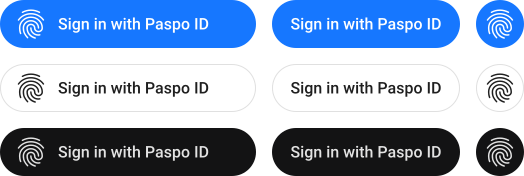
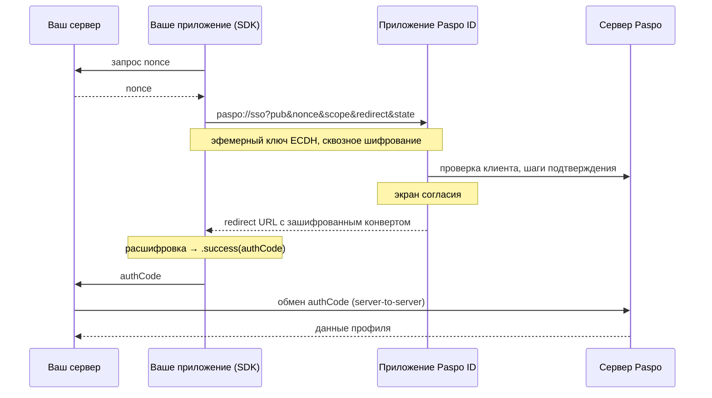

# Paspo ID iOS SDK

[English](README.md) | Русский

SDK добавляет в ваше iOS-приложение вход через **Paspo ID**. Пользователь авторизуется существующим аккаунтом Paspo в пару касаний, а ваш сервер получает подтверждённые данные профиля — телефон, e-mail или номер документа — без того, чтобы вы сами их собирали, проверяли и хранили.

## Содержание

- [Обзор](#обзор)
- [Требования](#требования)
- [Установка](#установка)
- [Настройка проекта](#настройка-проекта)
- [Быстрый старт: готовая кнопка](#быстрый-старт-готовая-кнопка)
- [Своя интеграция](#своя-интеграция)
- [Вход, начатый из Paspo](#вход-начатый-из-paspo)
- [Проверка доступности](#проверка-доступности)
- [Схема авторизации](#схема-авторизации)
- [Справочник](#справочник)
- [Безопасность](#безопасность)
- [Поддержка](#поддержка)

## Обзор

Интеграция — это один вызов `authenticate(scope:nonce:)`, который возвращает одноразовый код авторизации. Приложение передаёт код на свой сервер, а тот обменивает его в Paspo на данные пользователя. Со стороны пользователя всё выглядит так: нажать «Войти через Paspo ID», подтвердить на экране согласия и вернуться в приложение.

Обмен между приложением и Paspo сквозно зашифрован (ECDH P-256 + AES-256-GCM, эфемерные ключи живут только в памяти) и полностью берётся на себя SDK — криптографии на вашей стороне не требуется.

Две обязанности остаются на вашем сервере и не могут быть перенесены на клиент, потому что именно на них держится безопасность схемы: генерация `nonce` и обмен кода авторизации на данные пользователя.

## Требования

| | |
|---|---|
| Deployment target | iOS 15.0 |
| Swift | 5.9 |
| Конкурентность | обязательна; `authenticate` — `async`-метод |

Самому приложению Paspo ID нужна более новая iOS, чем SDK. Там, где его нельзя установить, `authenticate` вернёт `.notInstalled` — это штатный исход, его нужно обработать. Кнопку можно скрыть заранее через `isPaspoInstalled`.

## Установка

### Swift Package Manager

```swift
dependencies: [
    .package(url: "https://github.com/paspoid/ios", from: "1.2.1"),
]
```

```swift
.product(name: "PaspoID", package: "ios"),      // ядро, headless API
.product(name: "PaspoIDUI", package: "ios"),    // опционально, готовая кнопка
```

В Xcode: **File → Add Package Dependencies…** и вставьте URL репозитория.

### CocoaPods

```ruby
pod 'PaspoID', '~> 1.0'
pod 'PaspoIDUI', '~> 1.0'
```

### XCFramework

Собранные бинарники приложены к каждому релизу на GitHub. Перетащите `PaspoID.xcframework` в **Frameworks, Libraries, and Embedded Content** и выберите *Embed & Sign*. Собрать самому: `./scripts/build-xcframework.sh`.

## Настройка проекта

**0. Файл конфигурации.** Добавьте сервис в админке Paspo и скачайте `PaspoID-Info.plist`. Перетащите его в таргет приложения (отметьте «Copy items if needed» и принадлежность таргету). В файле всё, что SDK нужно знать о сервисе:

| Ключ | Что это |
|---|---|
| `SERVICE_ID` | Публичный идентификатор сервиса |
| `REGION` | Регион, в котором зарегистрирован сервис: `kz`, `ru`, … |
| `REDIRECT_URL` | Необязательно. Universal Link, через который Paspo ID вернёт результат; по умолчанию `https://{region}.paspo.id/mob/s/{service_id}?flow=phone` |
| `FALLBACK_REDIRECT_URL` | Необязательная запасная custom-схема |
| `BUNDLE_ID` | Необязательно; по умолчанию bundle identifier приложения |

С файлом вся настройка SDK — один вызов `Paspo.configure()`. Если файла нет или он битый, debug-сборка остановится и напишет причину.

**1. Redirect URL.** Paspo ID возвращает результат, открывая URL, принадлежащий вашему приложению. По умолчанию это ссылка возврата сервиса `https://{region}.paspo.id/mob/s/{service_id}?flow=phone`: `apple-app-site-association` для неё отдаёт Paspo, как только сервис настроен в админке. Вам остаётся добавить associated domain, для региона `kz` это `applinks:kz.paspo.id`.

Чтобы возвращаться через свой домен, задайте `REDIRECT_URL` и добавьте этот домен:

```xml
<key>com.apple.developer.associated-domains</key>
<array>
    <string>applinks:your.app</string>
</array>
```

Путь должен быть указан в файле `apple-app-site-association` вашего домена. В симуляторе Universal Links не резолвятся, пока AASA недоступен, поэтому в разработке обычно добавляют запасную custom-схему через `CFBundleURLTypes`.

Оба URL нужно зарегистрировать в Paspo при онбординге — приложение отклоняет неизвестные ему redirect-адреса.

**2. Схема `paspo` в `LSApplicationQueriesSchemes`**, чтобы SDK мог проверить, установлено ли приложение Paspo ID.

**3. Маршрутизация входящих URL в SDK:**

```swift
@main
struct YourApp: App {
    init() {
        Paspo.configure() // читает PaspoID-Info.plist
    }

    var body: some Scene {
        WindowGroup {
            ContentView()
                .onOpenURL { Paspo.shared.handle(url: $0) }
                .onContinueUserActivity(NSUserActivityTypeBrowsingWeb) { activity in
                    guard let url = activity.webpageURL else { return }
                    Paspo.shared.handle(url: url)
                }
        }
    }
}
```

В UIKit вызывайте `Paspo.shared.handle(url:)` из `scene(_:openURLContexts:)`, `scene(_:continue:)` и `scene(_:willConnectTo:options:)`.

Без файла те же значения передаются в коде:

```swift
Paspo.configure(
    PaspoConfiguration(
        redirectURL: URL(string: "https://your.app/paspo/callback")!,
        fallbackRedirectURL: URL(string: "yourapp://paspo-callback")!,
        serviceID: "S6eFaRtr",
        region: .kz
    )
)
```

Чтобы поменять настройку, которой нет в файле, загрузите его и поправьте: `var configuration = try PaspoConfiguration(); configuration.callbackTimeout = 300; Paspo.configure(configuration)`.

## Быстрый старт: готовая кнопка



Кнопка сама проводит весь сценарий по нажатию и блокирует повторные нажатия, пока идёт запрос. Ей нужны две вещи: провайдер nonce и обработчик результата.

```swift
PaspoSignInButton(
    nonceProvider: backend.requestSsoNonce,
    onResult: onPaspoResult
)
```

```swift
private func onPaspoResult(_ result: PaspoAuthResult) {
    switch result {
    case let .success(authCode): Task { try await backend.signIn(authCode: authCode) }
    case let .failure(error, _): show(message(for: error))
    case .cancelled, .notInstalled: break
    }
}
```

Внешний вид настраивается под ваше приложение:

```swift
PaspoSignInButton(
    scope: .phones,
    theme: .light,        // .brand (по умолчанию), .light, .dark, .neutral
    cornerRadius: 12,     // по умолчанию — «пилюля»
    nonceProvider: backend.requestSsoNonce,
    onResult: onPaspoResult
)
```

Для UIKit есть `PaspoSignInButtonView` с методом `setAuthHandler(scope:nonceProvider:onResult:)`. Если `nonceProvider` бросает ошибку, результат будет `.failure(error: .serviceUnavailable, ...)`.

## Своя интеграция

```swift
let nonce = try await backend.requestSsoNonce()
let result = await Paspo.shared.authenticate(scope: .phones, nonce: nonce)
```

Метод не бросает исключений: отмена, отсутствие приложения Paspo ID и любые ошибки возвращаются как `PaspoAuthResult`.

Два ограничения:

- одновременно выполняется только один `authenticate`; новый вызов отменяет предыдущий;
- экземпляр SDK должен пережить переход в Paspo ID и обратно — результат приходит URL-ом. Используйте `Paspo.shared` либо держите свой экземпляр там, где он не пересоздаётся при уходе приложения в фон.

## Вход, начатый из Paspo

Пользователь может начать вход из самого Paspo. Тогда Paspo откроет ваш redirect URL с меткой `paspo_signin` без остальных данных. Поддержка этой точки входа необязательна:

```swift
if Paspo.shared.isSignInRequest(url: url) { startSignIn() }
```

## Проверка доступности

```swift
if Paspo.shared.isPaspoInstalled { /* приложение установлено */ }
```

Проверка необязательна: `authenticate` делает её сам и при отсутствии Paspo ID передаёт вход в App Clip Paspo ID.

Если Paspo ID не установлен:

1. На iOS 17 и новее SDK открывает App Clip Paspo ID по стандартной ссылке Apple, передавая в ней тот же запрос. Пользователь входит в App Clip без установки, App Clip отвечает на ваш redirect URL, и `authenticate` возвращает те же результаты, что и с полным приложением.
2. На более старых iOS или если App Clip не открылся (ссылка не сработала, App Clip не появился за `appClipLaunchTimeout` или его карточку закрыли без запуска), SDK открывает страницу сервиса в Paspo ID `https://paspo.id/mob/s/{service_id}?flow=phone` (или `appStoreURL`, если `serviceID` не задан) и возвращает `.notInstalled`.
3. `nonce` этой попытки сохраняется и после установки Paspo ID уходит со следующим входом как реферал.

Чтобы не открывать App Clip, задайте `appClipURL = nil`.

`cleanup()` сбрасывает текущий сценарий и уничтожает эфемерный ключ. SDK вызывает его сам при завершении и ошибках; вручную — только если вы прерываете вход сами, например когда пользователь уходит с экрана.

## Схема авторизации



## Справочник

### PaspoScope

| Значение | Что получит ваш сервер |
|---|---|
| `.phones` | Номера телефонов |
| `.emails` | Адреса электронной почты |
| `.nationalID` | Номер документа, удостоверяющего личность |
| `.paspoID` | Постоянный идентификатор пользователя в Paspo |

### PaspoAuthResult

| Случай | Данные | Действие |
|---|---|---|
| `.success` | `authCode: String` | Отправить `authCode` на свой сервер |
| `.cancelled` | — | Пользователь закрыл экран согласия; обычно UI ошибки не нужен |
| `.notInstalled` | — | Ни Paspo ID, ни App Clip не смогли провести вход; SDK уже открыл страницу сервиса или App Store |
| `.failure` | `error`, `message` | Показать ошибку. `message` — для логов, не для пользователя |

### Ошибки

| Код | Случай | Значение |
|---|---|---|
| 100 | `.unknown` | Неизвестная ошибка |
| 101 | `.invalidRequest` | Некорректный запрос или повреждённые данные |
| 102 | `.serviceUnavailable` | Paspo временно недоступен |
| 103 | `.cancelled` | Пользователь отменил операцию |
| 110 | `.sessionExpired` | Сессия истекла; начните заново с новым nonce |
| 111 | `.packageVerificationFailed` | Приложение не прошло проверку Paspo. Проверьте, что bundle id и redirect URL зарегистрированы при онбординге |
| 120 | `.accessDenied` | Пользователь отказал в доступе |
| 121 | `.identityNotVerified` | Личность пользователя не подтверждена в Paspo |
| 122 | `.attemptsExceeded` | Слишком много попыток |
| 123 | `.actionNotAllowed` | Недоступно для этого пользователя |
| 130 | `.authMethodUnavailable` | Метод подтверждения временно недоступен |
| 131 | `.unsupportedAuthMethod` | Метод подтверждения не поддерживается |
| 140 | `.paspoNotInstalled` | Paspo ID не установлен |
| 141 | `.cryptoError` | Ошибка шифрования или расшифровки; повторите сценарий |

Коды совпадают с Android SDK — таблица ошибок одна на обе платформы.

## Безопасность

- Ключи эфемерные: на каждый `authenticate` генерируется новая пара ECDH, живёт только в памяти процесса и уничтожается после расшифровки ответа.
- Каждый ответ несёт `state` своего запроса; колбэки, не совпадающие с текущим сценарием, игнорируются — чужое приложение не подсунет результат.
- Генерируйте `nonce` на сервере и там же проверяйте его при обмене кода — это защита от повторного воспроизведения.
- `authCode` одноразовый и сам по себе не содержит персональных данных; данные пользователя передаются только по вашему защищённому каналу server-to-server.
- Для `redirectURL` предпочитайте Universal Link: custom-схему может занять другое приложение.
- Не логируйте `nonce` и код авторизации.
- `PaspoIDWire` — общий контракт обмена, а не публичное API; он открыт для самого приложения Paspo ID и может измениться в любом релизе.

## Поддержка

По вопросам онбординга (регистрация bundle id и redirect URL приложения, серверный API обмена): [paspo.id](https://paspo.id).
